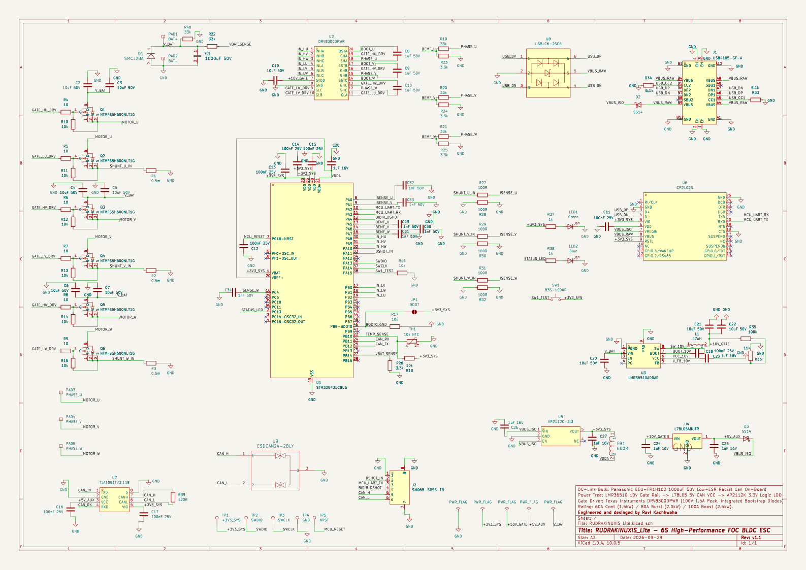
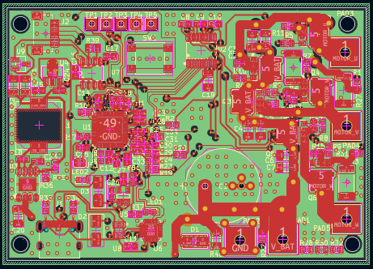
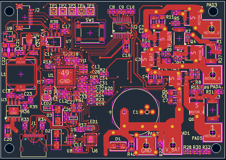
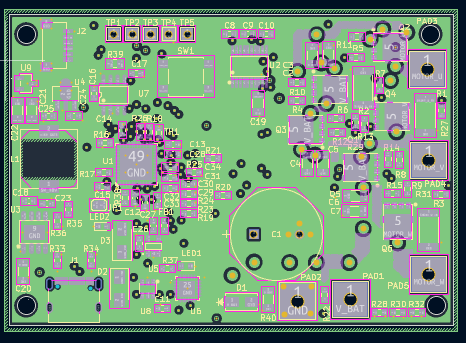
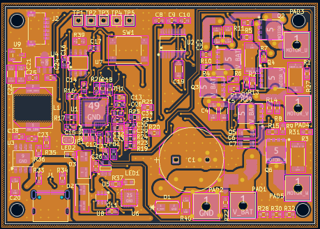
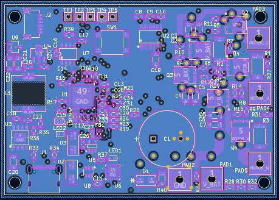

<h1 align="center">
   
  

   
  RUDRAKINUXIS-Lite
   
</h1>
<h3 align="center">
A fully open-sourced complete Field Oriented Control ESC. 
</h3>

| Front Render | Back Render | 
| --- | --- |
|  |  | 

## Schematics  

Here are the schematic design,

## Features
- **STM32G431CBU6 MCU** - Arm Cortex-M4 with CORDIC accelerator, running at 170 MHz.
- **A 24kHz 6S FOC motor controller and real-time DSP**.
- **Texas Instruments DRV8300 gate driver**.
- **600W continuous with 16 AWG bus wire and 2oz copper support**.
- Power and arming status indicator LEDs.
- High-speed CAN FD and DShot support.
- **USB C** - for flashing and telemetry.
- A 20-25.2V (6S LiPo) pad input for power.
- **3-phase 0.5mΩ low side shunts** - with dedicated Kelvin differential sensing.
- **LMR36510 synchronous buck converter** - high efficiency step down for the 10V gate rail.
- **AP2112K ultra low noise 3.3V LDO** - delivers clean, ripple free power to the MCU ADC.
- **Phase BEMF and bus voltage sensing** - for sensorless motor tracking and battery telemetry.
- **Onboard NTC thermistor** - for real time thermal monitoring and overheat protection.
- **USBLC6-2SC6 ESD protection** - hardware transient voltage clamping on USB data lines.
- **SWD debug header** - 5-pin port for direct ST-Link firmware flashing and live debugging.

## PCB Design 
|  |
|--- |  

 ### The PCB is 4 layers with dimensions 78.5000 x 55.0000 mm, made to be easily useable for anyone.  

 ### All the PCB files are [here](https://github.com/RaviKachhwaha/RUDRAKINUXIS-Lite/blob/main/hardware) 

| Front Layer | Inner Layer 1 |
| --- | --- |
|  |  |
| Inner Layer 2 | Bottom layer |
|  |  |

## Pinout  

This is a general pinout 

|  | 
| --- | 

(Credits to KiCad EDA for KiCad 10, STMicroelectronics for the STM32G4 MCU, Texas Instruments for the DRV8300 gate driver, and Hack Club for funding to make this possible.)

(Thanks to hack Club for funding.) 

## Why was it made?  

While using the normal old ESC for my many projects and in some times need's, I realised it doesn't have Field Oriented Control and high power support and I couldn't use it for high power and control needed project, unfortunately I had to think to buy a different high power ESC then I see that those have high power but not Field Oriented Control support or many have Field Oriented Control but cost very high and not have my needed pins and full control over every thing and use very low price components which give low quality, but now I designed one with the simplicity of STM32G431CBU6 with being able to get best Field Oriented Control and fastest processing and control over every thing and also programming support in a same board with high quality Field Oriented Control for best flight and have too many features and this will make many things possible.

## How you can get one for yourself? 

That is pretty easy, you have all the files you will need in the production folder, order the development  
board from any PCB fab ( I chose Lion Circuits or PCB Power cause its cheap in India and has good quality and also made in India ) and BINGO! You will have it to use for any purpose you want!  

## How do you use it?  
You can use it as any normal ESC board but first want to flash the firmware which is given in firmware folder, for flashing first connect the ESC to your computer via USB-C. Open your flashing tool (STM32CubeProgrammer or stm32flash), select the CP2102N COM port, and click **Download / Flash**. The onboard auto-reset circuit automatically enters the STM32 system bootloader, flashes the binary, and boots directly into your firmware and you are good to go!
I have attached a simple firmware to start with prebuild firmware available in the firmware folder.  

## BOM  
|Name|Purpose          |Quantity|Total Cost (USD)|Link               |Distributor|
|----|-----------------|--------|----------------|-------------------|-----------|
|PCBA|Board and Assembly|4       |194.20         |[Lion Circuits](lioncircuits.com)|Lion Circuits     |
|Electronic Components|BOM Component Sourcing|4       |189.85           |[Lion Circuits](lioncircuits.com)|Lion Circuits     |
|GenX Lithium Ion Battery - 6S|Lithium Ion Battery - 21.6V 9000mAh and 13C is needed to test this ESC without this there is no option to test it. So this is must needed.|1       |111.11          |[GenX Lithium Ion Battery](https://genxbattery.com/shop/genx-molicel-21-6v-9000mah-13c-premium-lithium-ion-rechargeable-battery)|GenX     |
| | | Total | 495.16 |

LCSC & DigiKey BOM for the components on board is [here](https://github.com/RaviKachhwaha/RUDRAKINUXIS-Lite/blob/main/components_bom.csv)

!!Thanks to ALL!!
